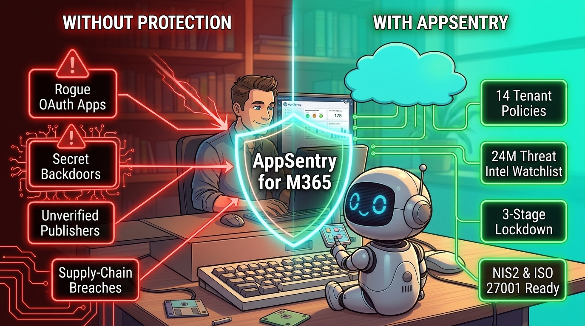

<p align="center">
  
</p>

<h1 align="center">🛡️ AppSentry for M365 (v2.0)</h1>
<p align="center">
  <strong>Bilingual (DE/EN) Read-Only Security & Supply-Chain Scanner for Microsoft Entra ID Enterprise Applications, App Registrations & Global Tenant Protection Policies</strong>
</p>

<p align="center">
  
</p>

---

## 🇩🇪 Überblick (Deutsch)

**AppSentry für M365** ist ein **ausschließlich lesend arbeitendes (Read-Only)** PowerShell 7 Sicherheits- und Compliance-Werkzeug für Microsoft Entra ID / Microsoft 365. Es kann Unternehmen dabei unterstützen, moderne **OAuth-Supply-Chain-Angriffen**, überprivilegierten Schatten-IT-Apps und unbemerkte Client-Secret-Hintertüren zu erkennen und das Risiko zu reduzieren.

### Die 3-Block Sicherheits- & Nachweis-Architektur
1. **Block 1 – 14 Globale Tenant App-Schutzeinstellungen (`T-01` bis `T-14`):**
   - Prüft User Consent (`T-01`), Gruppenbesitzer-Consent (`T-02`), App-Registrierungsrechte (`T-03`), Admin-Consent-Workflow (`T-05`), `defaultAppManagementPolicy` Passwort-Sperren für Apps (`T-07`) und Service Principals (`T-08`) sowie Gäste-Einschränkungen (`T-13`).
   - **Entra Directory Audit-Log Attribution:** Zeigt pro Einstellung exakt an, **wann** und **von wem (UPN + GUID + Property)** die Richtlinie in den letzten 30 Tagen geändert wurde.
2. **Block 2 – Prominente 24-Monats Threat-Intelligence Watchlist (23 Apps):**
   - Prüft den Tenant gezielt auf derzeit bekannte kompromittierte Drittanbieter-Apps (z. B. *ConnectWise Cloud Backup / SkyKick*, *Midnight Blizzard*), OAuth-Phishing-Apps und ungehärtete *Living-off-the-Land (LotL)* Admin-CLIs (*Microsoft Graph Command Line Tools*, *Azure CLI*).
   - **Grüner Negativhinweis (Stand der Watchlist, keine Garantie):** Listet sowohl im Tenant gefundene Treffer (Rot/Orange) als auch zum Prüfzeitpunkt **nicht gefundene** Watchlist-Apps (Grün) mit anklickbaren Originalquellen für CISO- & Audit-Berichte auf.
3. **Block 3 – Umfassendes App-Inventar & 3-Stufen Soft-Lockdown Generator:**
   - Bewertet jede App in 6 Risikodimensionen (IOC-Status, Passwort-/Rollen-Eskalation wie `Application.ReadWrite.All`, Directory Roles, API-Berechtigungen, Client-Secrets vs. Zertifikate, Governance).
   - **3-Stufen Lockdown-Playbook (`-WhatIf` First):** Generiert pro Zeile ein eigenständiges PowerShell-Skript (Graph SDK & REST API) inklusive Tenant-ID-Sicherheitscheck und `[CURRENT LIVE STATE]` Sofort-Verifizierung:
     - **Stufe 1 (Soft-Lockdown):** `accountEnabled = false` + `appRoleAssignmentRequired = true` (in der Regel reversibel, kein Berechtigungsverlust).
     - **Stufe 2 (Contain & Revoke Secrets):** Stufe 1 + Entfernung aktiver Directory-Rollen und Hintertür-Secrets.
     - **Stufe 3 (Hard Quarantine):** Stufe 2 + vollständiger Entzug aller API-AppRoleAssignments und OAuth2-Grants.

### Schnellstart (PowerShell 7+)

```powershell
# 1. Modul importieren
Import-Module .\src\AppSentry.psd1 -Force

# 2. Demo-Modus starten (ohne Cloud-Login zum Testen des HTML-Dashboards)
Invoke-AppSentry -DemoMode -Language DE

# 3. Live-Tenant Analyse (nur lesende Berechtigungen)
Invoke-AppSentry -Language DE
```

---

## 🇬🇧 Overview (English)

**AppSentry for M365** is a **read-only** PowerShell 7 security & compliance assessment tool for Microsoft Entra ID / Microsoft 365. It can help organizations detect and reduce the risk of **OAuth supply-chain compromises**, over-privileged shadow IT apps, and rogue client secret backdoors.

### Key Highlights
- **Block 1 – 14 Global Tenant App Protection Settings (`T-01`..`T-14`):** Evaluates User Consent, Group Owner Consent, app creation rights, Admin Consent Workflow, and `defaultAppManagementPolicy` password restrictions — including **Entra Audit Log attribution** (timestamp, UPN, GUID, modified property).
- **Block 2 – 24-Month Threat Intelligence Watchlist (23 Apps):** Screens your tenant for currently known vendor breaches (*ConnectWise / SkyKick*, *Midnight Blizzard*), adversary-in-the-middle OAuth apps, and unhardened *LotL Admin CLIs* — complete with a **Green Negative Hint (no guarantee)** for apps not present in your tenant.
- **Block 3 – Full App Inventory & 3-Stage Soft-Lockdown Generator:** Scores every Enterprise Application & App Registration across 6 risk pillars and generates self-contained PowerShell remediation scripts (Graph SDK & REST API) with `-WhatIf` dry-run mode enabled by default and live state verification.
- **Compliance Frameworks:** Built-in mapping for **ISO/IEC 27001:2022**, **NIS2 Art. 21**, **DORA**, **CIS M365 Benchmark v3.1**, and **BSI C5**.

### Quickstart (PowerShell 7+)

```powershell
# 1. Import Module
Import-Module .\src\AppSentry.psd1 -Force

# 2. Run Offline Demo Mode (generates interactive HTML dashboard)
Invoke-AppSentry -DemoMode -Language EN

# 3. Run Live Tenant Assessment (nur lesende Berechtigungen)
Invoke-AppSentry -Language EN
```

---

## 📄 License & Author
- **License:** MIT License (`LICENSE`)
- **Blog & Documentation:** [Security & Compliance Pro](https://www.security-and-compliance.pro/blog/)


---
## Hinweis / Disclaimer
DE: Bereitstellung ohne Gewähr; keine Garantie auf Vollständigkeit, Aktualität oder Schutzwirkung. Die Watchlist ist ein Stand und ersetzt keine eigene Sicherheitsprüfung.
EN: Provided as is; no guarantee of completeness, timeliness or protective effect. The watchlist is a snapshot and does not replace your own security review.

